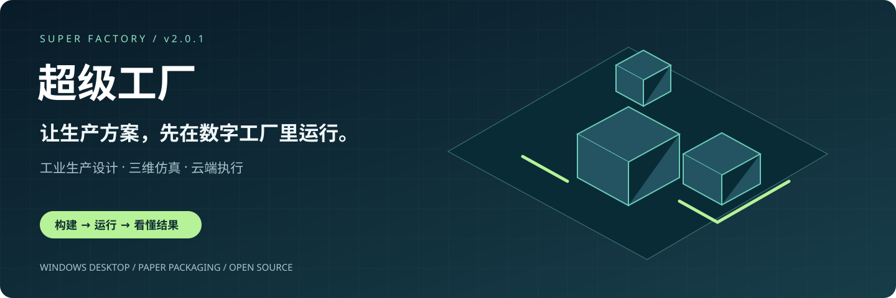
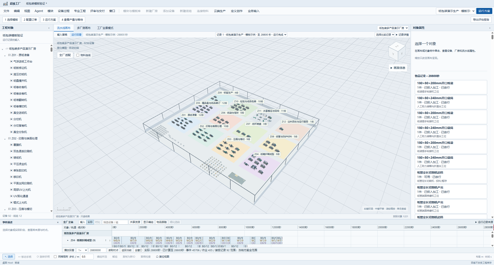
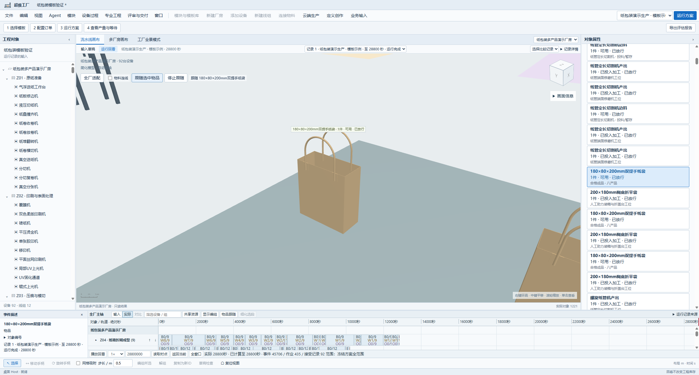
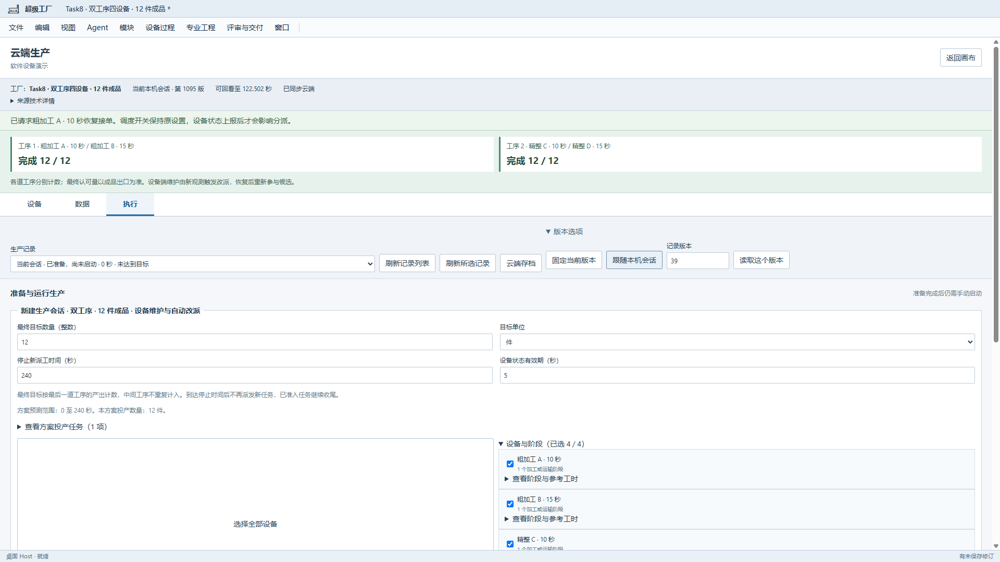

<strong>超级工厂——开源工业生产设计、仿真与云端执行平台</strong>

把厂房、设备、物料与订单放在同一工程中，搭建产线，运行方案，看清生产和运输的每一步。

<a href="https://github.com/JunyeFu/superfactory-releases/releases/tag/v2.0.1"><strong>下载 Windows 版 ↗</strong></a>　 ·　 <a href="https://github.com/JunyeFu/superfactory-releases/blob/main/USER_GUIDE.md">操作指南</a>　 ·　 <a href="#产品画面">产品画面</a>　 ·　 <a href="docs/DEVELOPMENT.md">开发者入口</a>

| 92 种设备 | 9 类模块 | 4 种报告格式 | v2.0.1 |
| :---: | :---: | :---: | :---: |
| 纸包装设备库 | 可编辑与组合 | PDF · HTML · CSV · JSON | 当前正式下载 |

## 在一座工厂里，看懂整个生产过程

*实际应用截图：纸包装多产品工厂。全厂布局、对象树、物品状态与时间轴在同一工作台呈现。点击图片可查看原图。*

从原纸准备，到印刷、成型、检验和搬运，超级工厂把设备布局与生产过程连接起来。适合教学演示、方案探索和工业仿真开发；首个专业场景聚焦纸包装。

## 产品画面

### 01 / 从工厂全景，走到一件产品身边

在全厂、流水线与物品跟随视图间切换。选中物品后，查看它所处的位置、状态和相关运行记录，沿时间轴理解加工与等待。

### 02 / 将云端设备与执行记录带回工作台

设备、数据、执行三个页签串联连接状态、查询与运行记录。图中为四个软件设备参与的双工序演示，两个工序均完成12件；实时云操作需要配置部署环境。

## 从方案到结果

| 工作环节 | 你可以做什么 |
| --- | --- |
| **搭建** | 从模板开始，组织厂房、设备和产线，调整布局、订单、物料与资源。 |
| **运行** | 计算生产与运输事件，在三维场景和时间轴中查看作业、流转与等待。 |
| **比较** | 查看方案结果与差异，导出 PDF、离线 HTML、CSV 和 JSON 评估报告。 |
| **接手** | 保存工程与运行记录，重新打开继续查看；通过共同操作层接入外部 Agent。 |

## 开始体验

**第一次使用，只需下载应用包。** 内置模板和操作指南已经随包提供。

1. [下载 Windows x64 应用](https://github.com/JunyeFu/superfactory-releases/releases/download/v2.0.1/SuperFactory-2.0.1-Windows-x64.zip)（约137.3 MB），完整解压后启动 `superfactory.exe`。
2. 选择 **从模板开始**，创建工程，选择“纸包装多产品工厂 · 92台设备”。
3. 使用模板演示配置，填写工厂前缀与方案名称，预览并创建，再点击 **运行方案**。

运行环境：**Windows 11 x64 + Microsoft Edge WebView2 Runtime**。希望直接浏览已保存的工厂与记录，可另下[示例工程](https://github.com/JunyeFu/superfactory-releases/releases/download/v2.0.1/SuperFactory-2.0.1-Example-Factory.zip)（约310.8 MB），通过“展示任务”打开其中的“纸箱产运演示”目录。

[完整操作指南](https://github.com/JunyeFu/superfactory-releases/blob/main/USER_GUIDE.md) · [离线指南下载](https://github.com/JunyeFu/superfactory-releases/releases/download/v2.0.1/SuperFactory-2.0.1-User-Guide.html) · [反馈问题](https://github.com/JunyeFu/openatom/issues)

## 开发与项目进展

**正式体验版本为 v2.0.1；下一完整版处于 FV0 缺陷与基线阶段。** 已提交的产品源码、H1离线复现工具和协作资料已汇入本仓库主线。整厂云全订单、长历史性能与独立人工操作验收仍在后续计划中，进度见[当前状态](docs/STATUS.md)。

| 入口 | 内容 |
| --- | --- |
| [开发指南](docs/DEVELOPMENT.md) | 环境、启动、构建与检查命令 |
| [仓库导航](docs/REPOSITORY.md) | 源码、模块、资源、研究和历史设计的职责 |
| [当前进度与协作](docs/STATUS.md) | 正式版与下一版的区别、FV0—FV4及任务入口 |
| [软件设计文档](软件工程/docs/README.md) | 业务需求、交互、架构和开发控制 |

技术栈：**Tauri · Rust · React · TypeScript · Three.js**。原创软件代码采用 [MIT License](LICENSE)；第三方依赖、字体和模型等资源遵循各自许可，见 [NOTICE](NOTICE)。
