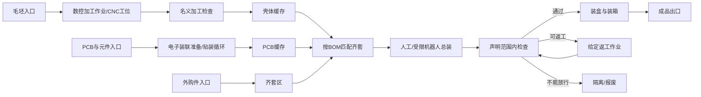

# 超级工厂：本次工厂类型与模块化设计

设计日期：2026-10-12。落实本轮用户要求：先限定可模拟工厂类型，权衡通用性、本次覆盖、展示与工作量，采用模块化串/并联，明确预留新增支持类型。本文为设计决策，不是实现或仿真验收报告。

## 1. 本次目标与范围决策

平台定位为“面向产业规划非专业人员及快速出方案工程师的开放工厂方案彩排平台”，首版以离散制造交付。常态为流水线画布和多厂房画布，单击打开对象详情；流水线画布随缩放采用详细、简化、区域三档表现。本次设计覆盖产品/物料定义、受限专业工程、工艺路线、工位与布局、资源/控制条件、串并联试产、逐件跟随以及工程接手。用户可以从外购零件、毛坯或指定工位开始，在加工完成、总装、包装或出库等合法终点结束跟踪。

本次限定三个工厂模板：A机加工交付、B外购件总装、C机电产品并行制造与总装。它们属于同一离散制造家族，不能按三个模板宣称已覆盖三个独立工业大类或大部分全国工厂。通用性通过相同机制改变产品、路线、布局和资源来体现。

|模板|可彩排的完整工作|专业范围|本次用途|
|---|---|---|---|
|A 机加工交付型|毛坯进机床→受限加工→下料/转移→名义检验→装盒/包装→出库|数控加工工程模块的固定刀轴三轴2.5D；可选有限机器人上下料；简单纸包装|主链之一，直观看见加工材料与物料状态变化|
|B 外购件总装型|外购件进入→分支备料/定位→按BOM齐套→受限总装→检查/返工→装盒→出库|自建刚体装配关系、给定紧固/连接动作、人工或受限机器人作业；明确检查条件|主链之一，体现单件如何进入装配体与包装箱|
|C 机电产品并行制造型|外壳加工线 ∥ PCB装联线 ∥ 外购件供料线→齐套汇合→总装→检查→包装|复用A/B，加电子装联准备与执行模块的资源准备、换线与板位循环；PCB工艺质量不由流程动画证明|综合路演模板，说明专业模块可以串并联组合|

三个模板应由同一组模块组装，不分别开发三套专用平台。C的产品/布局与数量变化同时作用于专业工程和工厂过程，承担本轮最完整的展示；A/B能独立打开，保留用户任意起点的追踪需求。

### 覆盖选择的取舍

|范围选择|通用性|画面与因果展示|增加的主要工作|决定|
|---|---|---|---|---|
|受限加工→检验→包装|零件加工交付共同任务|程序驱动名义材料变化、流转与包装|有限加工模型和工位接手|本次覆盖|
|外购件→装配→包装|避免所有产品都从自制开始；适合多种总装任务|齐套等待、装配关系、返工及箱件关系清楚|有限装配动作与物料关系|本次覆盖|
|加工/装联并行→总装|同一运行核心容纳不同专业支线|并行速度不匹配、共用资源和汇合阻塞可见|电子装联准备与执行模块支线与跨模块条件|本次综合展示|
|配料/混合/连续输送→灌装|可扩大到食品/日化/材料|罐管、液位、批次转单件更丰富|增加流量/组分/批次程序与清洗条件等不同机制|后续类型，不计入本次支持|
|服装、印刷等生产路线|可复用离散核心的相当部分|有裁片/卷张与后道转换|需要各自转换和工艺模型|保留接入路线，未独立列入本次模板|
|全部机床、复杂接触/材料与现场质量|扩大专业覆盖|更精细但输入/模型责任更多|大量专业数据、求解与验证责任|按具体新增类型另定，不作为本次完成条件|

选择依据是减少互不相同的物料机制，同时保留完整任务和专业因果；没有使用数字评分或虚构工时。本次共同运行对象为单件、批次中的离散件、装配体和容器。液体/散料连续流另有后续接入约定。

## 2. 参考产品与可修改对象

统一使用自建“桌面电子控制盒”工程作为综合参考，不使用客户CAD、真实订单或私有设备资料。

- 机械支线：自建受限外壳/板件毛坯、三轴加工、声明的名义几何检查。
- 电子支线：自建PCB板型、部件、供料器/吸嘴/板位与电子装联准备与执行模块循环；可改为直接采购完成PCB。
- 外购支线：盖板、连接件等自建输入；紧固件按明确数量需求表达，不要求每颗螺钉都承担高精度动画。
- 总装支线：定位、装入PCB/盖板、给定紧固与连接动作；几何关系与功能判据按声明模型组织。
- 包装支线：纸包装结构与成型工程模块的有限盒/内衬方案，成品装入、合盖/封装及装箱数量。

用户可以改产品几何、BOM、外购/自制、订单数量、工序方案、设备/人员、布局/输送、缓冲容量和检查条件。首版专业子集之外的要求在设计中明确标为待补专业模型，不把通用作业时长等同精确制造质量。

## 3. 两类模块需要区分

### 工程工具模块

数控加工工程模块产生加工工程与程序；电子装联准备与执行模块产生准备、配置和逐循环Job；机器人作业编程模块产生工作站、运动与事件；纸包装结构与成型工程模块产生结构、使用过程及制造资料；控制柜设计与制造交付模块产生认可连接、布局/布线和资料；公差与装配条件模块产生装配与检验条件。

它们用于设计与修改。工具产生的工程经专业人员确认后，成为对应虚拟工位的作业输入。一个包装结构文件不自动包含装盒机动作；一个控制柜接线图不自动产生独立控制程序。

### 工厂过程模块

它们接收物料与已确认作业，管理动作、资源、时间、状态和移交。模块几何与专业计算在需要时驱动过程；工厂层负责串并联与共享资源。两层共享产品和工程对象，分别承担设计责任和过程责任。

|过程模块族|接收与输出|核心责任|可复用到哪里|
|---|---|---|---|
|入口/出口|给定物料实例或批次→进入/退出工程范围|型号、数量、属性、到达条件；外购件或任意起点|所有三个模板|
|加工/作业|输入件→加工或作业后的件|使用认可作业、资源与完成条件；改变几何/业务状态|CNC、贴装、给定清洗/固化等后续工序|
|搬运/输送|一处物料→另一处物料|路径、位置、容量、资源与移交|输送带、有限机器人、人工/搬运车|
|缓存/库存|物料进入→按规则可取|容量、排队、存取与占用|齐套区、工位间缓存、暂存|
|装配/齐套|按BOM匹配的多路输入→装配体|数量、版本/规格相容、共同任务、动作与部件关系|外购总装与机电汇合|
|检验/处置|物料→通过/不合格/待处理等明确结果|读取有来源的观测/计算或声明的结果模型，按判据分流|名义几何、装配条件、特定视觉例|
|包装/装箱|成品与包装物→包装件/箱|装入关系、动作和箱件数量；保留来源关系|A/B/C的成品交付|
|控制与资源|信号、设备/人员条件→运行许可与状态|独立控制逻辑、联锁、动作顺序、资源占用与释放|设备、工位及共享资源|

“给定清洗/固化”只能表示用户声明的作业条件；未接入相应物理内核时不发布洁净度、化学转化或温度分布结论。

## 4. 串联、并联与回流怎样组装

### 串联

工位输出是下游要求的物料类型与状态。下游能接收时移交；不能接收时，上游/指定缓存保持物料，画面显示等待或阻塞。已完成加工不自动意味着检验合格，也不自动意味着已经交给下一工位。

### 并联加工与汇合

不同物料支线可以同时推进。汇合依据同一产品BOM、规格/版本及数量齐套，不以两个图标相碰代表总装。例如一个参考产品需要一个壳体、一个PCB和四个紧固件；只有相应物料和作业资源具备条件，才开始装配。具体数量为自建示例，不是通用规定。

组装产出保存所用部件关系。被跟踪的壳体进入装配体后，用户可以继续跟随该装配体，查询壳体仍在其中；包装后同样进入箱件关系，而不是把原件删除后生成无关新图标。

### 平行设备与替代路线

同类工位的多台设备是择一派工；多个部件支线是同时齐套；条件分流是按检验/工艺条件选去向。三者分别表达，不能把所有分叉都解释成一件物料同时复制到各线。

### 返工回流

检验不合格可以按明确规则进入返工、复检、隔离或报废；返工次数/允许动作由场景声明。路线不能无条件循环产生更多物料。拆卸或拆包若属于本次具体场景，应恢复明确部件/容器关系，不假定每种装配都可无损拆回。

### 综合工厂拓扑

纸包装结构与成型工程模块向K提供包装工程；机器人工艺向相应搬运/作业工位提供运动与事件；控制柜工程提供设备电气设计分支。工程工具不是每个零件必经的流水线节点。

## 5. 模块新增支持类型的接入约定

预留支持类型必须体现为一套可描述的接入约定与设计样例。当前不声明已有可加载插件或代码API。

|模块说明项|必须表达什么|作用|
|---|---|---|
|身份与种类|模块类型、版本、工程工具或过程模块|能识别模块承担的责任|
|输入/输出|物料或工程对象、数量/单位、允许状态、必要坐标|决定能否串联及是否需要转换模块|
|参数与作业|专业参数、认可作业及人工固定条件|保留模块精度和用户意图|
|资源与能力|设备、夹具、人员、容量以及占用/释放条件|决定并发能否成立|
|运行与时间|开始/完成/等待条件、由平台事件或专业求解驱动、交换时点|使不同模型能共同彩排|
|结果与变换|几何/状态/数量怎样变；切分、合并、装配或装箱关系|支撑跨模块物料跟随|
|画面与编辑|参数面板、对象视图、运行状态、结果显示|新增模块在统一工作台中可理解可操作|
|适用与精度|明确的模型责任、输入依据和不能得出的结论|保持专业精度，不以图形效果替代计算|

模块内部专业算法由模块承担。平台理解其输入输出、资源与事件，不要求平台核心知道每种刀路、装配算法或纸盒结构。

同一个工位可以选择明确的作业条件模型、可运行行为模型或专业计算模型；连接与视觉外形不能自动升级计算精度。工具只产生计划、参数或几何时，其结果怎样变成过程作业需要明确。

### 预留新增样例一：固化工位

仍属离散物料机制。输入给定装配体，占用有容量的工位，根据认可作业完成等待/固化流程，输出具有相应声明状态的件。可以复用现有物料、资源与事件约定，作为机器人点胶后的可选串联工位。只有作业时长/条件模型时，说明支持流程彩排，不宣称已预测材料转化率。

### 预留新增样例二：多腔成型工位

引入批次到多件的物料转换，表达每循环的材料输入、型腔数量和残余物料。必须有转换规则和来源关系；不能像普通单件加工那样凭复制图标增加产量。具体成型物理需要对应专业模块。

### 预留新增样例三：配料—混合—灌装类型

液体/散料使用流量、存量、组分与批次语义，不能接到只接受离散件的端口。需要新增明确物料端口、过程模型和离散化转换模块，再接包装支线。模块化可复用产品/资源/空间及展示概念，但新物料机制可能需要扩展共同运行层，不承诺新增任意领域都无需改变平台核心。

### 设计展示中怎样体现预留

- 模块目录将“本次支持”“设计接入样例”“后续专业类型”分开显示；未支持类型不能作为本次可运行能力。
- 在工艺图中展示固化工位插入点与同类并联工位，说明串联新增和资源共享如何成立。
- 给出一份模块说明模板、一个有限作业模块接入样例及不相容物料连接的处理方式。
- 工厂模板是模块实例与连接的配置；同一模块可以在不同模板使用。新增类型原则上增加自身说明、专业计算/行为、画面及示例工程，而不是复制整套平台。

## 6. 设计彩排的画面与用户流程

用户先选择A/B/C模板或由模块组装路线，定义产品/BOM、入口和终点；确认外购/自制、专业作业、物料、资源与布局；检查连接和齐套条件；启动彩排；切换全厂、工位、专业工程与单件跟随视图；暂停后修改方案、形成新的彩排情景；比较并交付工程。

常态只有两张画布：流水线画布和多厂房画布，菜单切换。流水线缩放采用详细、简化、区域三档，直到单厂房总览；放大不能进入设备页。

单击进入设备/对象详情，专业工作台、工艺关系、物品经历及全厂时间轴在详情或面板查看，不成为另外两张常态画布。关闭详情恢复原画布位置。专业工作台按完整模块名称显示输入怎样改变结果。

同一彩排情景使用明确版本的产品、路线与作业。修改已开始的工程时，新情景与原情景分开，避免给在途物料无说明地换几何或BOM。后续若要求生产运行中的实时切换，另定义其切换条件。

## 7. 本次主演示

|演示|用户改什么|应该看见的因果|承担的覆盖|
|---|---|---|---|
|A加工交付|工具可用性或受限特征|专业加工方案/名义材料变化→工位条件与流转改变→检验/包装接手|专业深度与串联|
|B外购总装|部件到达、规格或数量|齐套等待、已到物料保留→总装关系→检查与包装箱关系|任意入口与逐件跟随|
|C并行工厂|设备数量、布局/缓存或订单结构|并行支线速度/共享资源变化→等待/阻塞/产出差异→完整工程解释|模块组合与工厂层作用|
|新增类型设计例|串入给定固化工位，或增加同类平行工位|接口与资源变化如何接入同一工厂|明确模块化新增，而非未完成能力宣传|

演示参数为自建声明条件。流程吞吐或等待结果必须来自相应模型；名义工位完成不等于现场质量通过。本轮只设计演示，不生成真实运行结论。

## 8. 研究工作量收敛

本次六专题中的1/2/3是新增研究主干；5/6按上述三个模板补齐必要检查、返工和人员/资源/控制条件；4保留模块接入与物料机制设计，详细食品/日化工厂研究后置。

专业模块本次采用已有受限范围，不同时扩到所有机床、任意装配接触、所有检验仪器或任意包装机构。电子装联准备与执行模块可单独解释其完整准备/循环工程；并行模板也允许明确选择采购完成PCB，但采购路线不计作已运行自产装联。

交付设计包应包括三个模板的输入/决定/输出、模块目录与接入约定、串并联工艺和产品关系、布局/资源、两画布与详情交互、四组演示、支持范围及新增类型样例。实现仍按已拆分任务推进，不能据此保证一人20天完成所有专业内核。

2026-10-13更新：三份独立模板及匹配的模块定义已归入[三类工厂模板与接手](../../软件工程/docs/01_业务需求/三类工厂模板与接手.md)，两画布、单击详情及专业面板关系已直接修正。新增模板仍是设计，专业/软件执行结果为空。

## 9. 来源与关联

本次范围与模块边界是基于既有研究作出的设计决策，非行业覆盖统计或原创性结论。

- [工厂设计彩排研究缺口](工厂设计彩排研究缺口与顺序.md)
- [现有课题覆盖核对](课题覆盖与实现状态核对.md)
- [前五题设计状态](../../../历史独立方案/汇报材料/软件过程预览/项目与状态.json)
- [设备行为与控制联调模块](../../../../../知识库/行业选题数据库/扩展研究/赛道一新版作品/N20.md)
- [仓储布局与作业规划模块](../../../../../知识库/行业选题数据库/扩展研究/赛道一新版作品/N22.md)
- [完整公差/装配工程](../../../../../知识库/行业选题数据库/扩展研究/行业机会发现/2026-10-12_排水信号与公差工程共性/完整任务比较与公差工程备选.md)

## 实现与社区入口
阶段及目录见[项目实现](../../软件工程/README.md)，设备/物品/人工任务/移动资源/物流/模板各类均按独立模块贡献。静态图、动图、模型共用行为规则，自定义设备入口不要求编程或三维建模。模块接入清单已补充表现与贡献信息。

## 现行平台与首版范围

本文件中的专业能力是研究储备与机制设计，不是全部首版承诺。首版平台包括九类自由创作/社区扩展、真实外部Agent一句话目标/场地模板填充及有限模拟修正、四格式报告；保留3通用离散模板，另加纸箱制造生成配置，真实专业只选纸包装结构/成型。机加工和电子在首版用声明过程，不因研究有完整内核而自动加入。

[项目主线](../../软件工程/docs/00_项目基线/项目主线.json) · [生成规格](../../软件工程/docs/03_架构与契约/目标驱动厂房生成.md)。
