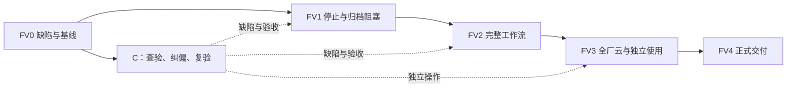

> **当前分工（2026-11-03）** FV1 的三项出口由 A 完整负责，FV2 起按每人每包 8–10 小时交付。当前主责、包边界与批次顺序见[完整版工作包与阶段分工](完整版工作包与阶段分工.md)，下方原卡保留功能和验收要求。

**2026-11-04 验收变更**　所有阶段取消真人体验任务，包括首次盲测、同伴手动操作、求助统计及基础 20／进阶 30 分钟目标。基础与进阶流程改由工具按指南操作，记录候选版本、输入、界面结果和失败步骤。既有 UIA 记录可按其实际覆盖范围接收。

# 入围后完整版制作与验收方案

日期：2026-10-31。状态：**FV0诊断已收口，指标按《FV0冻结基点与输入》第10节执行**。本文件及[任务卡](入围后完整版任务卡.md)按用户要求提出下一完整版本的标准、查验、修复、协作与接收办法。实际入口见[GitHub协作入口](GitHub协作入口.md)。不是新一轮测试结果，也不改变 v2.0.1 的历史验收结论。

2026-11-01安排复核：保留五阶段、15张卡；修正候选包前置、分段输入交接、指标责任、候选云环境、工期和接收规则。以下已更新为复核后的安排，不增加产品实现或通过记录。

## 1. 版本范围与完成定义

以正式 v2.0.1 为使用基线，沿用原 V2-00—V2-11、任务8需求和未关闭缺口；ST01—ST08作为已交付阶段保留。下文 FV0—FV4 是下一轮的执行批次，任务卡是原包的具体切片，不另建产品需求体系。新版本号在候选冻结时确定。

完整版本包括：92设备本地工厂、93端点整厂云端软件在环执行、维护改派、数据服务、生产与运输同源呈现、报告导出、正常收尾、长历史保存和新进程重开，以及按指南可复现的基础与进阶流程。设备侧仍是独立虚拟进程；实体设备接入只有实际完成并验证后才能写入能力声明。

不自动增加新行业、企业多租户、移动端、全局最优调度、更多模型或真机协议。新增目标要说明替换什么、影响哪个出口，不能只追加到当前阶段。

**完成必须同时满足：** 本文适用硬要求通过；当前范围内无阻断使用或造成错误结果的缺陷；必需查验没有“未测”；源码、运行包、指南与示例对应同一候选；接手者能独立完成基础流程。可以延期纯外观微调，但有明确影响和记录，不能把本轮必需项延期后仍称完整版完成。

## 2. 缺陷起点：事实、修复状态与待查验分开

|对象|当前可确认的事实|本轮分类与入口|
|---|---|---|
|整厂停止与排空|历史整厂云运行出现待出料未结清、无法正常退出；后续有限路线正常停止已验，整厂全量未闭合|高优先级历史缺陷，先最小复现；V2-04/FV01、V2-06/FV01|
|长历史归档|历史记录出现分配失败、保存未完成，内存提交峰值至少23.8 GB；共享归档字节等修复已落地，仅短会话恢复通过|高优先级修复后规模待验，禁止重新标为完全未修；V2-09/FV01|
|93端点通信|历史发送日志的观测HTTP平均耗时约601—731 ms，连接复用试探已有记录；这不是p95、画面延迟或真机产能|已观察性能现象，先分解瓶颈再决定优化；V2-10/FV01、V2-03/FV01|
|控制文档|部分入口仍写“先完成v1”“待做”或旧发行名称，与已完成的ST及正式发布记录冲突|当前可直接核对的文档缺陷；V2-00/FV01|
|运输历史回看白屏|v2.0.1已补transport类型分支，并经过重新下载实测|已修复回归项；不再作为开放缺陷重复开发|
|大报告卡顿|38,849条等待曾引发卡顿；现有100条分页、技术详情按需展开已验证|已修复回归项；长历史扩展另按实际负载测量|
|界面整齐度、术语、首次使用|C已交UI自动化操作表和22项反馈，A已归类；已接收工具操作记录，继续按候选核对界面与术语|查验任务，不能预先给所有页面判缺陷；V2-07/FV01|
|完整厂房云画面、长跑、全订单结果|本地整厂证据存在，整厂云端对应结果仍未闭合|验收缺口；V2-10/FV02，不按“缺证据”直接重写产品|

证据入口：[FV0输入与历史接收摘要](FV0输入与交接.md)、[H1内部输入下载](https://github.com/JunyeFu/openatom/releases/tag/fv0-inputs-20261101)、A现行本地[开发控制计划](开发控制计划.json)的 `full_factory_cloud_extension`、[指南实走](../../.work/v2-full-target-20261028/guide-walkthrough-20261029.json)、[正式发布收尾](../../.work/v2-full-target-20261028/presentation-copy-20261029.json)。H1真实快照/历史和原工程已上传私有Release；原长历史保存失败、没有成功存档的事实保留。本规划分支不夹带其他人的未提交控制增量。其余旧本地原始路径若已归档，消费既有归档，不为查因恢复整套构建缓存。

每个新问题先标为“确认缺陷 / 已修待回归 / 查验缺口 / 环境阻塞 / 改进建议”。严重性独立记录：P0为数据损坏、越权或重复生产等正确性问题；P1为主流程阻断、无法停止保存、错误业务展示；P2为可绕过的功能/体验问题；P3为外观偏好。历史崩溃不能掩盖，未复现的疑点也不冒充现存根因。

## 3. 前端设计规范

沿用[工业工作台规范](../02_交互设计/工业工作台母版与字段细化.md)及已采用的配色、组件和两画布结构。以下是本轮新增的明确检查口径，不要求整体换主题或重做全部页面。

|编号|要求|怎样接收|
|---|---|---|
|FE01 信息层级|每个页面有明确任务名称、对象上下文和主要操作；主要区块同一时刻突出一个主操作。调试字段、原始JSON、修订ID默认进入详情，业务判断必需的来源/单位保留|先查启动、模板、订单、云生产、查询、报告、保存打开7类关键任务；剩余可达页面做一次清单走查，记录实际例外|
|FE02 字号与排版|正文16 CSS px、表单/表格14 px、辅助信息不小于12 px；沿用8 px间距倍数，紧凑关联项允许4 px。标签、输入、按钮按列对齐；同类控件共用样式|尺寸是本轮设计要求，不是当前已达标结论；检查真实界面及现有样式，不逐页面复制新样式|
|FE03 适配|1920×1080/100%与1366×768/100%完整检查关键路径；1920×1080/150%检查导航、表单与弹窗。关键操作可达，无文字覆盖、截断错误提示；表格可局部横滚，整页不因固定侧栏挤掉主操作|3D画布按可用空间布局；长名单、空值和中文长名称各查一个真实样例，不做全部组合矩阵|
|FE04 可读与可操作|普通文字对比度至少4.5:1；状态有文字，不能只靠颜色。独立可点击控件至少24×24 CSS px，主要按钮建议高32 px以上；键盘焦点可见，表单按Tab可达|采纳W3C相应准则作为项目要求，不宣称全应用已获得WCAG认证；3D拖动提供现有数值/按钮入口|
|FE05 完整状态|空白、加载、无结果、失联、失败、只读各有清楚说明和可执行下一步。超过1秒的操作显示真实进行状态；无法量化时用阶段文字，不编造百分比|错误说明“哪一步未完成、当前内容是否保留、可做什么”；不得把未提交显示为保存成功|
|FE06 业务语言|按钮采用“动作＋对象”；术语在界面、指南、报告中一致。主界面不用Run、epoch、binding、payload等内部术语代替业务名称；详细诊断可保留|C 对照界面与指南定位不一致的术语，并给出业务替换句；开发者核对语义，不批量替换状态词|
|FE07 整厂呈现|默认简化精度可辨设备、工序、等待、工件、运输和成品；同一产品可定位、跟随、看经历；详细档按用户选择启用|不以静态截图证明生产；按本轮实际Run核对投入、持有、移交和产出。共用逻辑可复用设备家族证据，新增绑定独立查|
|FE08 大列表|报告、历史与导出文件列表按需读取/展开/分页；保留现有每页100条报告行为，筛选必须作用于完整结果|38,849等待记录回归：首屏、翻页、跨初始页筛选、对象定位、导出结果均正确；不靠删数据提速|

外部依据：[W3C文字对比度](https://www.w3.org/WAI/WCAG22/Understanding/contrast-minimum.html)、[W3C点击目标尺寸](https://www.w3.org/WAI/WCAG22/Understanding/target-size-minimum.html)。24 px在W3C原文有间距等例外；本项目对独立按钮直接采用最小尺寸，正文行内链接按相应例外处理。

## 4. 操作逻辑与使用方式

|编号|必须成立的行为|最小验收场景|
|---|---|---|
|OP01 三个入口|“从模板开始”无需另下示例、无需云凭据；“展示任务”明确选择示例工程；“空工程”明确是自行建模，不暗示已经能生产|全新用户配置下只按包内指南操作；必填项、保存位置和打开目录写清楚|
|OP02 状态与来源|本地仿真、实时云执行、历史回看明确区分；方案、当前运行、已保存工程分开；一个工程共用业务状态和时钟|改订单重跑产生新结果，旧Run保持；历史回看不下发新生产命令|
|OP03 编辑与离开|未应用字段、已应用未保存、已保存可辨；离开未提交表单提供应用/丢弃/留下；撤销不回滚已发生的生产或外部命令|修改→切页→返回；修改→应用→保存→重开；重复点击不重复提交|
|OP04 派工与维护|维护后不接新任务；已开始作业的处理符合原契约；兼容替代设备承接未开始工作；恢复以有效新观测为准|一次维护→承接→恢复，核对身份、数量与占用；未知执行不能盲目重发|
|OP05 暂停、停止、关闭|暂停派工不等于设备急停；正常停止停止新工作并按契约完成在途作业/物料移交。若无法排空，显示实际阻塞对象和原因，不假报完成|正常全量结束；中途请求停止；已观测待出料路径。结清后正常关闭，无强杀作为通过证据|
|OP06 断线与权限|失联保留真实状态，不把旧观测当新状态；只读身份不能写；凭据仅进入现有私有连接机制|一次必要断连/恢复与关键拒绝；不得将凭据放到Issue、截图、导出工程或公开运行包|
|OP07 持久化|保存失败保留上一个有效工程；新进程恢复原工程、模型版本、旧Run、产出运输和历史；不要求用户找开发目录|大历史一次成功保存/重开，另验一个可控失败保留路径；禁止为通过改写原历史|
|OP08 接手|基础用户可下载、建模板、运行、查看产出、保存重开；进阶用户可改订单、新建方案、比较、导出并解释差异|由未参与该功能实现的人实际操作；观察者不代点、不口头补步骤，帮助发生就记录卡点|

用同一候选、示例和指南执行基础及进阶流程，逐项保存操作结果。下载、生产等待和界面响应用各自的技术指标。

## 5. 后端、性能和资源要求

### 5.1 测量边界

所有数值是要求或拟定预算，不是新增通过结论。旧v1的48窗口/1800操作/40次存取矩阵不恢复。本轮测量只覆盖当前完整版负载与受影响接口。

FV0记录实际CPU、内存、GPU、Windows/WebView2、显示设置、云服务和数据库规格、网络路径、候选提交及构建profile/调用。B交环境版本与缺项，A接收；在双方约定的首个工作时段反馈，不预设未确认的1日截止。拟以Windows 11 x64、16 GiB内存、SSD为体验预算环境；这是目标机档位，未经实测不能宣传最低配置。云端先沿用已批准资源，不自动购买或扩容；既有15代币不是已查明的当前剩余额度。

冻结三个输入：L1为现有92设备/69订单本地模板；C1为93端点完整云工厂；H1仅指已存在的历史失败归档负载。C1实际最终历史是FV3产生的验收输出，不能反过来作为FV0基线或FV1归档修复的前置；FV3仍需验证该最终历史保存重开。C1正常场景的旧参考为1578阶段命令、273趟运输；FV0从冻结工艺独立确认各产品接受量和单位。167是异种单位合计，不作为单一“成品件数”。维护场景命令数可能不同，不能把参考总数写死替代业务核对。

### 5.2 本轮门槛

|编号|指标和要求|最小测量方法|
|---|---|---|
|PF01 业务正确性|重复/乱序回执不重复扣料或产出；资源无冲突；全部订单按各自单位交付；无未知未结清命令冒充完成|沿用受影响Engine/Host反例＋C1同一次实际运行的结果核对；模拟加速结果不作真实云时长|
|PF02 交互|选择、详情、有效参数应用的正确反馈p95≤200 ms；长任务1秒内给出进行状态|L1预热后每类30次，一轮计量，nearest-rank p95；失败保留。测到Host确认后的正确呈现，不把输入框变化当完成|
|PF03 画面|默认简化档下，整厂播放和产品跟随各60秒窗口，中位FPS≥30；单次无响应>2秒列缺陷定位|真实Native前台、固定视角/负载；记录帧间隔及最大停顿，不以视频30fps替代实测。详细档记录结果，不暗降模型质量|
|PF04 查询|沿用原百万数据、原始/聚合各30次、完整分页p95≤2秒的协议；正确性独立核对|未变链路复用原证据，改查询/索引/分页则重跑相应固定查询；不把首HTTP页耗时冒充完整查询|
|PF05 云反馈|沿用设备发送至正确UI呈现p95≤2秒的目标，并在C1规模验证；记录设备→云、云→Host、Host→UI分段与总体|固定100个样本，使用同钟或可解释的保守上界。601—731 ms平均HTTP旧观察不能充当该指标；网络异常单列，实际失败不删除|
|PF06 内存|FV01 在 A 当前 Windows 本机实测应用进程树 Private Bytes，峰值≤6 GiB；固定H1、相同页面/对象、无新增生产数据的10分钟重复读回场景，预热后至末尾Private Bytes增量≤512 MiB|FV0冻结读回动作和采样；进程树包含Native/WebView2和本机执行客户端。记录工作集作为辅助观察，2小时活动生产的内存随记录数另列；不把合法历史增长直接判泄漏，不通过截断历史达标|
|PF07 归档|L1保存/打开各≤10秒；H1完整保存≤60秒、新进程可操作≤60秒；操作期间进度真实、UI可响应、旧有效工程保留|先离线复现历史归档，解决后再做C1。只做一轮有效成功及受影响失败边界；数据/文件规模与耗时同时记录|
|PF08 长运行|C1全部订单完成，并覆盖累计至少2小时的代表性实际工作；没有持续订单时以预先固定的独立批次构成负载|不能用完成后空闲挂机补足稳定性证据；不得让重复批次覆盖原Run或冒充一批产量。出现正确性、失控增长或保存阻塞就停止扩量并定位|
|PF09 大报告|现有38,849等待样例首个有意义内容≤5秒；翻页/筛选正确反馈p95≤500 ms；完整内容可导出|Native与离线HTML各查一次；预先固定20个翻页/筛选操作；不得通过只筛当前页或删记录实现速度|
|PF10 交付体积|运行包保持资源闭包，不带target、node_modules、私有连接和开发记录；以137.3 MB为比较基线|增长超过20%时解释实际新增文件，不用压缩率代替功能或删必需模型；没有新增内容就不重复打包|

PF06—PF09中的新增预算在FV0提交基线与取舍后冻结。不能测完发现不达标再由执行者自行放宽；如果预算确实与实际目标机/业务规模不符，由你明确调整要求并保留理由。未测为未测，超标为超标；不恢复历史穷尽矩阵，也不为了数字引入未证明必要的缓存、队列或新服务。

### 5.3 原任务8要求的接收归属

|原需求|本轮消费位置|证据方式|
|---|---|---|
|T8-F01—F04：PaaS、设备接入、采集、DaaS|V2-03/FV01、V2-02/FV01、V2-10/FV02|部署/身份已有证据按差异复用，整厂链路和修改后的查询实测|
|T8-F05—F07：模型绑定、来源、生产任务|V2-06/FV01、V2-07/FV02|冻结设备/工艺/订单映射，前端实际消费|
|T8-F08—F11：派工、命令、执行效果、改派接管|V2-04/FV01、V2-06/FV01|最小反例和C1正常/扰动运行|
|T8-F12—F13：界面与可解释过程|V2-07/FV01—FV03|实际工作流、单产品与命令/回执定位|
|T8-F14：Agent共同授权|V2-08/FV01|现有真实stdio/Host消费者，按改动补验|
|T8-F15—F16：持久化、预测比较与交付|V2-09/FV01—FV02、V2-11/FV01|H1归档恢复、同口径比较、实际文件及独立运行包|
|T8-Q01—Q02：权限、指令与业务一致|V2-03/FV01、V2-04/FV01、V2-08/FV01|拒绝/重复/乱序/未知结果等受影响边界|
|T8-Q03—Q04：规模与反馈|V2-02/FV01、V2-10/FV02|原百万/10路30分钟证据按差异复用，新增93端点实际负载；端到端时延单独测|
|T8-Q05：既有行为保持|V2-07/FV03、V2-10/FV02、V2-11/FV01|原本地模板、旧Run、保存重开、报告与正式包回归|

完成时逐组给出“已有适用证据 / 本轮新验 / 未满足”，不能只列15张卡关闭数量替代原需求覆盖。

### 5.4 指标不能只有要求、没有负责卡

|检查项|实现/诊断负责人及原卡|最终接收|
|---|---|---|
|FE01—FE08、OP01—OP03/OP08|C查验，A在V2-07/FV02修工作台；报告与查询页面的独立文件由B对应卡处理|C的V2-07/FV03；未覆盖页面保留待验|
|PF01、OP04—OP06|A的V2-04/FV01、V2-06/FV01；B负责设备/云边界|A运行V2-10/FV02，B核对业务结果|
|PF02—PF03 交互/画面|B在FV0提供测量方法，A在V2-07/FV02处理已定位的界面/场景热点|FV3同候选下B计量、C检查可见行为；C不承担性能数字采集|
|PF04 查询|B的V2-02/FV01|B交固定查询结果，A复核口径|
|PF05 云端到画面|B的V2-03/FV01负责设备/云链，A负责Host/界面消费者|FV3统一时钟/上界方法采样，不能分段达标后相加猜测|
|PF06—PF07、OP07 内存/归档|B的V2-09/FV01，Host接点由A合入|FV3保存、新进程恢复及资源结果；不以工作集单一变化断言泄漏|
|PF08 长运行|A的V2-10/FV02，B测量，C查变化工艺画面|同候选完整工作负载和正常收尾；失败回到具体拥有者卡|
|PF09 报告|B的V2-09/FV02|C看可读与操作，A核对比较口径和输出|
|PF10及源码/资源闭包|B的V2-11/FV01|A接收，C使用实际下载副本|

PF06—PF09性能预算仍是待FV0冻结的设计值；已有强制正确性、权限、持久化要求不等待预算冻结。首轮测量用来判断目标可行性，冻结后的正式验收不能为消除失败擅自改门槛。

## 6. 其他软件质量与比赛评价

|维度|完整版本要求|验收输出|
|---|---|---|
|可维护性|公共类型和业务归属保持单一；改公开字段同步真实生产者/消费者；PR只含本任务增量|受影响模块检查＋一位非作者审查；不为覆盖率数字写镜像测试|
|可扩展性|使用既有模块契约，完成一次修改订单/替代设备/采用已有模块的实际接手|可编辑工程及操作步骤；不新增没有消费者的抽象|
|可靠与安全|保存、授权、重复命令、外部输入和并发边界正确；不泄露连接信息|对应必要反例；数据丢失、越权、重复生产为发布阻断|
|部署与复现|指定源码提交能按锁定依赖构建；运行包独立启动；本地基础流程不依赖私有云凭据|必要资源、LICENSE/NOTICE、启动与构建说明，实际下载→使用→保存重开|
|可访问与兼容|目标Windows环境、屏幕缩放和键盘入口有实际结果；其他平台不泛化承诺|记录已验证配置；不自动恢复已取消的第二机门槛|
|技术创新|讲清共用模型/运行状态、数据驱动派工、人工与Agent共同接手如何解决问题|一个可重复案例，展示输入→机制→变化→结果；模型数量和AI使用本身不算创新证据|
|场景落地|在同一输入下完成完整生产与一次扰动，解释产出、等待、恢复及运送|按产品分别报告量/单位；没有现场数据就不写工业增效比例|
|开源治理|评审能访问声明的完整源码提交、构建说明、许可证及一个可用扩展示例|公开运行包不能单独替代源码交付；私有仓库须实际授予评审访问或发布获准源码|
|长期发展|三个人的模块责任明确，已知支持边界、后续计划与当前能力分开|维护入口、可认领Issue和一次真实接手；不虚构用户、贡献者或商业收益|

比赛维度沿用项目[比赛设计要求](../05_开源与参赛/比赛设计要求.md)中已核读的技术创新30%、场景落地30%、开源治理20%、长期发展20%。2026-11-01检索到的[赛事官网](https://www.oschina.net/oa2026/)索引与上述权重一致，列出11月6日公布入围、11月13日决赛；直读页面未返回可解析正文，个人下一赛段通知仍待确认。11—22净工作日是完整版工量估计，不是本届赛前日历承诺；投入与交期由A结合B/C基线确认。详见[A首卡交付](FV0冻结基点与输入.md)。这里的指标是内部准备要求，不生成模拟官方分数或获奖概率。

软件硬要求全部通过以后再做展示加分。沿用既有PDF/视频制作安排，本方案只规定版本、能力表述和使用入口的接收要求，不自动派发整套重制。正式提交与GitHub发布分别记录。

## 7. 三人职责与协作边界

|角色|主责|交付与审查|不承担的隐性任务|
|---|---|---|---|
|A：你，核心开发与集成|Engine/Host业务状态、停止/改派、公共契约、主工作台逻辑、最终集成与范围决定|接收B的PR；把C的问题转成修复；最终候选冻结。自己的核心改动由B审查|不把所有页面目测留到最终一天；不同时维护多套“当前状态”|
|B：另一位大规模开发者|归档与数据性能、云服务、设备SDK、报告、Agent消费者差异验收、候选构建和云部署准备|提供可独立验证的PR；审查A核心代码；按文件交接接入Host|不自行修改Engine业务规则、公共schema或主工作台；需要跨界改动交A处理|
|C：前端纠偏与真实体验|逐任务查漏、文案/布局建议、录制最短复现、基础与进阶实走、修复后的体感复验|每个问题给实际/预期/位置/严重性；验收FE/OP。能编码时可认领明确的纯样式/文字卡，默认不要求会写代码|不承担后台根因、性能压测或“再看看所有页面”的模糊任务；不代替开发者填后端通过|

文件所有权按任务卡，而不是让两位开发者同时写整个packages目录。A独占公共domain/生成契约、Host会话及Engine；B在归档卡独占`execution_archive.rs`和相应测试，Host接入交A。`Workbench.tsx`与公共CSS集中由A提交；C给修改清单，若C接纯CSS则A暂停同文件编辑到交回。报告与云查询各自独立文件归B；查询界面具体为`CloudDataExplorer.tsx`、`cloudDataPresentation.ts`和`cloudDataExplorer.css`，与A的云生产容器分开。

共享Native和同一云工程同一时刻只有一个操作者。C查验时A/B继续无界面工作；需要云测试按卡预约。多人本机工作可分别使用各自环境；本机不复制完整模型/缓存给每个任务。一次最多两张实施卡加一张体验查验卡，每人一张在办主卡。

## 8. 五阶段顺序与完成关口

时间为计划估计，假设两位开发者接近全时投入、C每天可安排一个检查时段；不是历史实测或承诺日期。目标日期未提供，FV0后按真实投入修订。

|阶段|目的与任务卡|并行方式|出口|估计工作日|
|---|---|---|---|---|
|FV0 缺陷与基线|V2-00/FV01控制和输入冻结；V2-07/FV01体验查验；V2-10/FV01性能与失败基线|A先交最小输入，B测量后A冻结预算；C直接使用正式包|已确认缺陷、已修回归、待查验分清；源码基点/负载/指标/责任确定|1—2，输入等待另计|
|FV1 阻塞修复|V2-04/FV01停止；V2-09/FV01归档；V2-03/FV01设备链路|A做业务；B归档2—4日后链路1—2日串行，C复核提示|最小失败路径正常；完整归档可恢复；无P0/P1阻塞再放大到整厂|3—6|
|FV2 完整工作流与候选准备|界面/整厂/查询/报告/Agent五卡；V2-11/FV01候选准备；V2-10/FV02启动准备|A做前端、业务和联验脚本接线；B做查询、报告、Agent及候选包；C分批复验|适用消费者闭合；交候选包/指南/示例及隔离云候选；A的准确运行说明和短链接线可供FV3|4—8，FV0据适配量复估|
|FV3 整厂与独立使用|V2-10/FV02全厂云与长跑；V2-07/FV03独立体验；最终C1报告读取|A单独操作云/Native，B计量；C先用同候选包查离线任务|全订单、运输、正常停止、长历史、性能、报告和基础/进阶全部适用项通过|2—4|
|FV4 正式交付|V2-11/FV01正式接收检查点；V2-11/FV02材料对应|复用已验候选；B准备交付，C查发布副本，A接收|完整源码/包/指南/示例及材料一致；实际发布/提交另记，不覆盖已提交入口|1—2|

原10—18日估计没有充分计入同一负责人串行任务，撤回作为总工期参考。按修正后的阶段范围相加约11—22个净工作日，两开发者并行；不包含输入/权限等待、额外缺陷返工和超出工作日的实际运行占用。C每天可用时段、三人投入和目标日期未确定，因此还不能给出可靠日历完工日期。FV0后按真实可用量校准；不能把设计估计写成工期承诺。

外部复核对结构给出“有条件启动”，不视为工期已获验证：其角色工时示例未完整计入Agent、交叉审查及联验脚本适配。FV0排期须纳入这些已分配动作，不另加无依据的固定缓冲天数。

### 8.1 分段交接，解除前置互等

1. **FV0先交输入，再冻结指标。** A在#1先交代码基点、H1获得方式/实际文件、已有运行说明和云权限/预算情况；无需等#1全部关闭。B确认输入可用后在#2实测，A再据基线冻结预算。#2不以#1“已关闭”为前置；#1也不把B完整结果作为交付H1的前置。H1缺失时#2只能部分开展，FV0出口仍开放。
2. **候选包前移。** V2-11/FV01有两个检查点：FV2末的候选准备、FV4的正式接收。前者在业务集成后构建一次，包含指南和示例，供FV3使用；后者复用已验包完成发行核对。二者是同一卡，不新增任务，FV3不等待FV4关闭。
3. **报告先小例接通，再读全厂结果。** FV2报告卡用已有真实小云案例及38,849等待样例验证接口/比较/分页；FV3得到C1后再读同候选整厂报告和输出。FV2出口消费报告的实现接收检查点，不要求这张卡的最终C1验收已完成；FV3也不能遗漏报告接收。
4. **冻结后有修改就更新候选。** FV3发现产品问题，退回拥有者修复、B重制受影响候选，重新验证受影响链路；纯文案和无关已有证据按差异复用。不能用旧候选体验和新候选后台结果合并宣布一个版本全部通过。
5. **脚本接线提前，完整联验不提前。** V2-10/FV02由A在FV2末先完成历史脚本适配与短链接线；该检查点消费B已交的候选，不反向阻塞B制包。现存脚本有本机绝对路径及旧场景常量，具体清单见输入说明；完整C1及长运行在FV3执行。FV3与FV4保持相同构建profile，变更profile须核对受影响性能结果。

首批交接还须指明38,849等待样例和小云比较案例的实际工程/运行记录及打开步骤；历史JSON摘要不等于可运行输入。源码环境与候选资源的取得入口见[FV0输入与交接](FV0输入与交接.md)。本次第二遍复核只修正交接说明、工作区命令和文件归属，没有实际构建或新增产品验收结果。

### 8.2 云环境与交付保护

A在FV0确认测试资源/连接授权、实际可用预算和隔离方式；B在V2-03/FV01交候选镜像、配置、必要迁移及恢复说明，在获准环境部署候选并做短链检查，最迟在FV3开始前完成。若云端代码/配置完全未变，可以由A确认复用适用环境及证据。

FV2后续查询或服务修改使旧镜像失效时，B在候选准备检查点更新云镜像并复验受影响短链。交接同时列桌面源码提交、云镜像版本和冻结输入，不能用FV1旧镜像配FV2新代码作同候选验收。

测试代码、数据库和逻辑工程与现有对外演示服务隔离；同一数据库仅分项目不能隔离服务代码和schema变更，不能以此替代独立候选环境。没有预算/权限/隔离环境时，继续本地与离线工作，云验收标阻塞，不覆盖现有sf-cloud或已用数据库。候选部署失败时恢复/停止测试候选，不能用旧数据迁移来试错。

现有v2.0.1标签、发布资产、下载页和原源码分支保持。FV4准备新版本独立交付；更换已提交入口或正式发布仍需对应授权。本方案的查验不触发部署或资源购买。

### 8.3 缺陷处理、材料与关闭责任

C的问题由A在每日短收口时段完成分类和归属；P0/P1直接阻断相关路径，其他无依赖工作继续。C负责复现/复验，不因是发现者就自动承担修复。P2若违反本轮必需FE/OP要求仍须关闭，不能用“可绕过”规避；非必需建议可由A明确延期。一次最多两张实施卡和一张查验卡。

每个Issue交付实际结果后再由接收者关闭；能力已满足且证据适用允许零代码修改。合并PR不自动等于验收。阶段按所有适用要求关闭，不按Issue关闭数量计算产品完成率。

已有PDF/视频只做差异接收：C指出差异，A确认原作者是否继续承担；作者未明确则该材料结果保持未完成，不能默认三人之外有人会自动补齐。软件交付与比赛三材料就绪分别记录，不把外部材料等待卡成全部研发停工。



阶段出口限制的是交付验收；没有真实依赖的设计、离线查验可以提前。已具备冻结基点、复现输入和适用要求的FV1修复可以由A按卡确认开工，不要求所有FV0外部事项先结清；未完成项仍阻止FV0整体关闭及其依赖路径。严重问题挡住关联链路，不让所有人空等。一次完整测试失败后先缩到失败路径，修复后复验受影响部分；不能连续启动长跑寻找一次偶然成功。

## 9. GitHub派发与接收

建议使用**源码所在仓库的Issues＋一个Project＋PR**；公开运行包仓库只放发行内容。当前本地源码分支为`codex/superfactory-cloud93-20261029`，HEAD为`19d789b9`，且有既存未提交改动；FV0先区分来源并固定下一轮集成基点，不能直接让别人基于所有本地脏改动开工。

1. 你管理源码仓库访问；A/B需要提交PR的权限，C至少可读取代码/Issue并提出问题。用户已确认B为`wwl-ww`、C为`Jacky-z-q-wan`，两人已有write权限，首卡分别指派#2和#3；不新增邀请。仓库开放或权限变更由你明确执行/授权。
2. 五个Milestone对应FV0—FV4。每张任务卡创建一个Issue，标题保留`[V2-xx/FVxx]`；使用现有bug/enhancement类标签，新增仅限`type:check`、`area:ux`、`area:cloud`等确需筛选项，不建标签百科。
3. Project状态：待澄清→可领取→进行中→待复验→完成；阻塞作为明确原因/依赖，不和“正在做”混用。字段只保留负责人、阶段、优先级，依赖用原生blocked by。GitHub支持Issue依赖及Project同步，依据[Project文档](https://docs.github.com/en/issues/planning-and-tracking-with-projects/learning-about-projects/about-projects)、[依赖文档](https://docs.github.com/en/issues/tracking-your-work-with-issues/using-issues/creating-issue-dependencies)。
4. [任务卡](入围后完整版任务卡.md)是可直接复制的静态派发说明。未派发时它定义工作；派发后Issue记录每日状态和讨论，不再在本地重复维护一个实时看板。原开发控制JSON只在阶段接收时更新实际结果，不自动改旧包为全部完成。
5. 每张卡一个主责。分支用`codex/v2-xx-fvxx-short-name`；PR引用Issue，写“触发→原行为→新行为、改哪些文件、实际验证”。不能仅凭PR合并自动关闭Issue；涉及界面由C复验，涉及内核/数据由另一开发者审查，A最终接收。
6. 实施前确认实际前置、文件范围与对应版本；若定位发现需要修改他人文件，先提出精确接口差异，由A重新分配，不私自扩大。任务执行中不不断插入新要求，每个工作日一个短收口时段看PR、阻塞和C的最高优先级问题。
7. 在Issue里只放最短复现和必要截图；完整工程/大日志引用项目现有私有产物位置，公开Issue提供脱敏小样例。不要上传云凭据、全量历史、整套模型或私人目录信息。

第一批3张已建立：A=`V2-00/FV01`，B=`V2-10/FV01`，C=`V2-07/FV01`。三人可先并行开展版本梳理、源码/记录诊断和真实体验；B的H1输入及[离线复现工具](../../tools/fv0-h1/README.md)现已交接，可按说明独立运行。工具采用全部观察历史和明确标注的重建基线，Host保存/重开测量不代替原完整快照密度及Native指标验收。FV1的修复卡随后按实际发现领取，不一次让15张卡同时开工。

## 10. 查验报告与接收格式

C每个问题用下面六项即可，截图圈注能说明就不录长视频：

```text
使用版本/入口/环境：
我想完成什么（含输入和从哪里开始）：
最短操作步骤：
实际发生了什么 / 预期应当怎样：
影响与可否绕过（建议P0—P3）：
一张截图或短片段；建议修改（可选）：
```

开发交回补充：修改文件与提交、实际检查命令/输入/结果、适用范围、未解决项。接收者只核对这一卡的要求，不再重复全产品矩阵。设计通过、编码完成、局部通过、真实使用通过和发布成功分别标记。

用户已授权同步方案、建立五阶段及FV0三张Issue；当前采用Issue＋Milestone，没有新建Project看板。本轮不启动云资源、不恢复旧自动化、不更新发布版本。用户已确认B/C账号，按角色指派首卡；三人投入时间及目标日期仍待补充，指派不等于本人已开工或完成；原已提交发布链接和内容保持。
