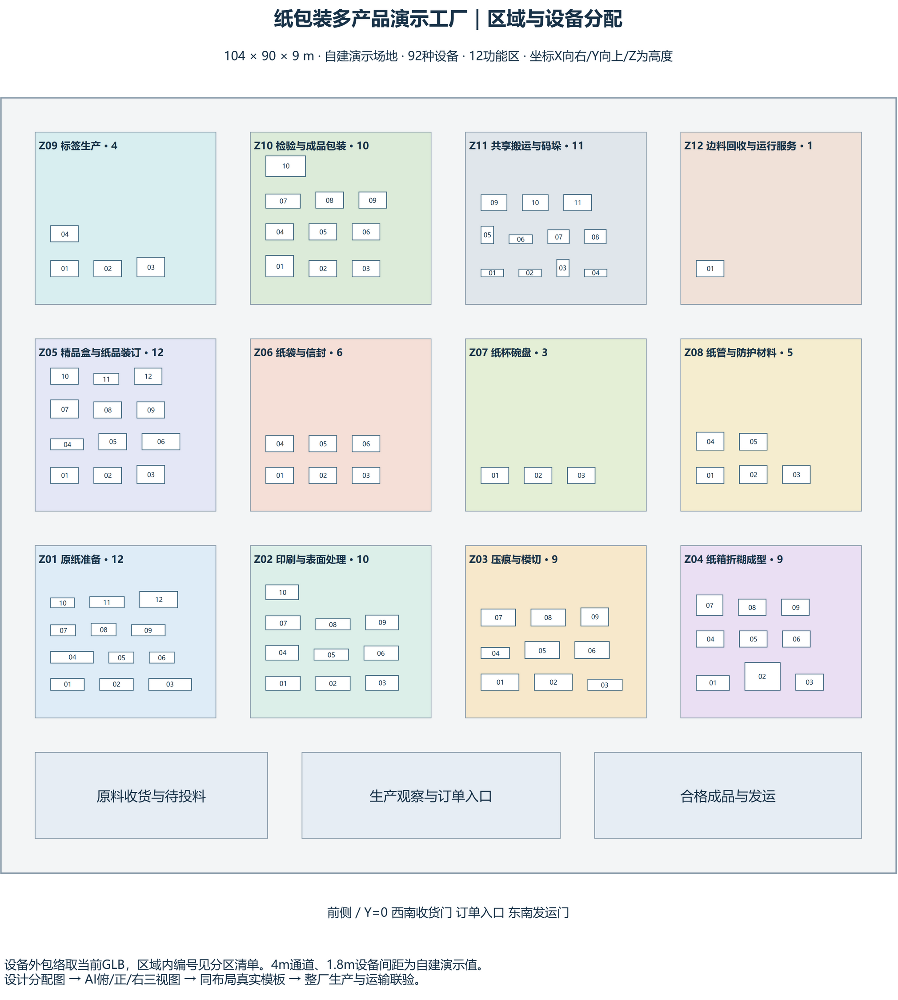
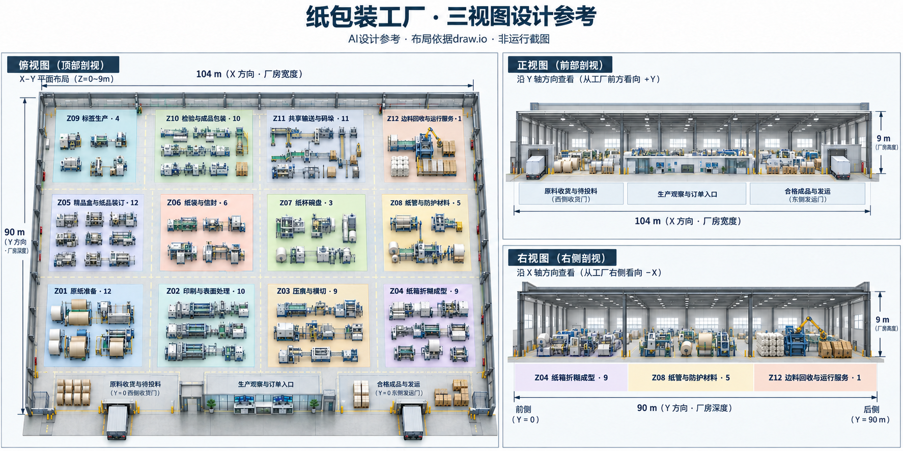

# 纸包装演示工厂设计

归属原V2-05-G01.layout、V2-07-G01.views及后续V2-05-G01.build；执行状态统一取[开发控制计划](../开发控制计划.json)的`gap_alignment`。

布局为104×90×9米的自建演示厂房，12个功能区覆盖当前已接收的92种设备。设备外包络来自当前详细GLB，4米通道和1.8米设备间距是本演示的设计选择。具体设备版本、姿态和区域取[layout.json](../../../../modules/templates/paper-packaging-factory/design/layout.json)，[分配表](../../../../modules/templates/paper-packaging-factory/design/equipment-allocation.csv)可逐项核对。

- [可编辑draw.io](纸包装整厂区域与设备分配.drawio)：区域与设备总图、三页设备清单、产品路线与共享物流分配、纸袋物料联线，共6页。
- [布局预览](纸包装整厂区域与设备分配.png)：从原draw.io实际导出，包含可编辑图数据。
- [AI三视图](纸包装整厂_AI三视图.png)：俯视、正视、右视，同一方向和尺寸。右视图已修正为Z04→Z08→Z12；初稿保留供核对。

AI图用于外观和区域关系参考，具体机器形状、精确数量及位置采用现有模型和分配表。图上的产品不构成实际生产数据。

当前源码模板 `community.template-paper-packaging-factory@1.2.0` 包含五条成品路线和一条提手预制支线，公共Host已实际完成预览、采用、运行、保存和新进程精确重开：145次制造作业、78趟运输、33件成品。1.2.0普通桌面候选仍须重建和验收，随后使用“从模板开始”中的纸包装92设备模板、“使用模板演示配置”、工厂前缀和方案名称创建。不能套用下面1.0.0的桌面结果。

旧模板1.0.0已通过实际Host和两个普通Native进程保存与精确重开，原Run逐字段一致；普通界面完成43.422秒、100秒、1800秒和反向回看。证据：`F:/SuperFactory-v2-temp/01a1731e/full-factory/template-host04/receipt.json`、`template-native/native-02/flow/receipt.json`、`template-native/native-03/reopen-resumed/receipt.json`。该Native通过源码联接复用资源，独立交付包另验。旧模板源文件另保存在`modules/templates/paper-packaging-factory/versions/1.0.0/`，原工程与Run保持。

当前连续路线为盒坯送料→压痕→折糊；装箱→封箱→贴标→捆扎→最终检验；卷管→切成两段→分别精磨；标签印刷→模切→检验→剥离；制袋筒→侧褶展平→糊底→开袋→双提手粘接。提手支线用6次捻绳和3次人工预制，得到3副双绳柄。19台设备已联线，其余73台仍是独立正常工况。3只180×80×200mm纸袋各追溯到一段530×240mm纸幅、6条纸条、4片预涂胶补强片和实际用胶；纸体积一致。原人工装箱台同时服务三项纸袋工序，合计12次作业，工位和操作员占用无重叠；补强片只够两副时只接受2袋，缺胶时0袋。详见[纸袋设计页](纸袋联线与物料设计.png)与`F:/SuperFactory-v2-temp/01a1731e/full-factory/bags-host03/bag-materials-receipt.json`。

1.2.0模板依赖846个实际使用版本，其中750个复用仓库包、96个工厂模块；派生素材共5593224字节。92台设备的定义引用不变；两台纸袋设备采用显式夹具呈现覆盖，原几何保留。原模板1.0.0和1.1.0源另存于`modules/templates/paper-packaging-factory/versions/`。源构建器为`tools/v2-demo/prepare_factory_template.py`，真实Host消费者为`tools/v2-demo/src/full_factory.rs::template_bags`，当前精确路径和所有剩余动作取原开发控制计划。

归档画布的0秒/7200秒正反向读取、92设备素材、33件入库和纸袋近景已查，错误为0；成品双提手可见，证据`F:/SuperFactory-v2-temp/01a1731e/full-factory/bags-render02/receipt.json`。这只覆盖归档渲染，普通Native和实际工序中间时点仍未验。接下来按V2-07-G01补厂房/区域、出货台与自由缓冲区的支撑、主要文字和单件跟随；其他产品族、云阶段、报告和最终影片保持原队列。

重生成布局：在软件工程根运行`python tools/v2-demo/prepare_full_factory.py`。脚本读取现行接收目录，生成设计数据、分配CSV和draw.io，不生成Run或修改接收状态。实际项目准备器为`tools/v2-demo/prepare_full_factory_project.py`；其中历史模型生产者仅消费当前源，在私有输出生成输入，两处旧生产者增加`--input-only`以保留原接收记录。

统筹设计接收：现draw.io有6页（原5页加纸袋联线），三视图是明确标识的AI设计参考。92设备ID、精确版本、姿态、区域所属产线与实际1.3 Host采用工程逐项一致；104×90×9米及前/右方向一致。分配CSV的工艺绑定状态保留最初设计时点，不充当运行进度；当前真实路线/联动状态取开发控制计划和实际Run。已完成设计不重复生成，后续布局变动仍按原规则同步；本接收不代全厂生产、最终Native或影片。回执：`.work/v2-full-target-20261028/factory-layout-reference-reception.json`。
